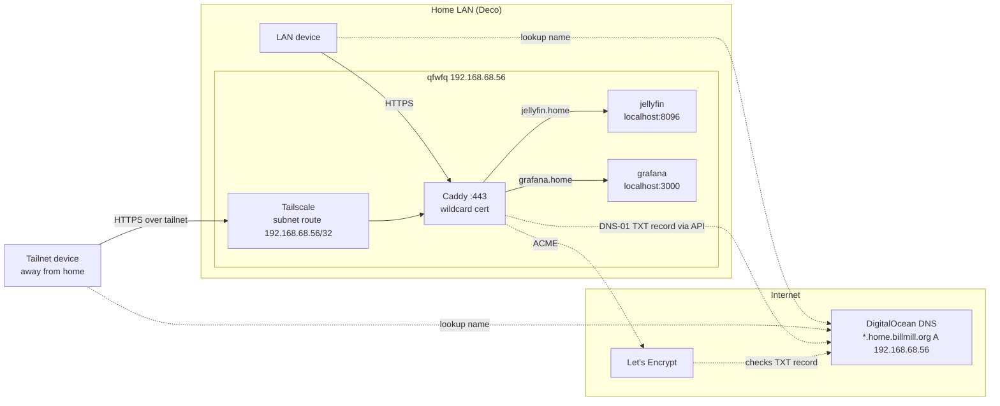

# qfwfq

Caddy on qfwfq (a Mac mini) serves internal services at
`https://<name>.home.billmill.org` with a real Let's Encrypt certificate. They
work on the home LAN without Tailscale, and from anywhere on the tailnet.

| service  | url                                  | upstream         |
|----------|--------------------------------------|------------------|
| jellyfin | https://jellyfin.home.billmill.org   | `localhost:8096` |
| grafana  | https://grafana.home.billmill.org    | `localhost:3000` |
| shifgrethor (Synology DSM) | https://shifgrethor.home.billmill.org | `https://100.81.92.46:5001` (Tailscale) |

## How it fits together



- **DNS**: a public wildcard A record `*.home.billmill.org -> 192.168.68.56`
  (qfwfq's LAN IP) in DigitalOcean. The Deco has a DHCP reservation that keeps
  qfwfq at that address.
- **TLS**: one wildcard certificate, obtained with a DNS-01 challenge through
  DigitalOcean's API. Let's Encrypt can't reach a LAN IP, so the HTTP
  challenge won't work. This needs a caddy build with the
  [caddy-dns/digitalocean](https://github.com/caddy-dns/digitalocean) plugin.
- **Away from home**: qfwfq advertises `192.168.68.56/32` as a Tailscale
  subnet route, so tailnet devices reach the LAN IP from anywhere. It's a /32,
  not the whole /22, because other Deco networks use the same 192.168.68.x
  range by default.

## Files

- `Caddyfile` -> `~/.config/caddy/Caddyfile`
- `org.billmill.caddy.plist` -> `~/Library/LaunchAgents/`, a launchd agent
  that starts caddy at login and restarts it if it dies. It logs to
  `~/Library/Logs/caddy.log`
- `env.example` -> `~/.config/caddy/env`, mode 600, with a DigitalOcean token
  that has the domain create, read, and delete scopes. Not committed
- `mount-video.sh` -> `~/bin/`, and `org.billmill.mount-video.plist` ->
  `~/Library/LaunchAgents/`. Keeps the video share mounted; see below
- `install.sh` copies everything over ssh, validates the Caddyfile, and
  restarts both agents. `--upgrade` also downloads a new caddy build to
  `~/bin/caddy`

## Video share

Jellyfin's libraries live on `smb://shifgrethor.local/video` (a Synology),
mounted at `/Volumes/video`. If the mount is missing, playback fails with
"fatal player error" and ffmpeg logs `No such file or directory`.

A launchd agent runs `mount-video.sh` at login, every minute, and on network
changes. If the share isn't mounted, it mounts it with `osascript mount
volume`, which can create the mount point under `/Volumes` without root.
Failures back off exponentially up to an hour, so a bad password doesn't trip
the Synology's Auto Block. It logs to `~/Library/Logs/mount-video.log`.

The password is a keychain item only `/usr/bin/security` can read. Create it
on qfwfq (it prompts for the password):

```sh
security add-generic-password -s org.billmill.mount-video -a llimllib -T /usr/bin/security -w
```

If the Synology password changes, rerun that with `-U` added.

## Adding a service

macOS's Local Network privacy blocks the launchd-run caddy from connecting to
LAN addresses (`dial tcp ...: connect: no route to host`). Proxy other
machines through their Tailscale IPs instead.

Add a matcher and handler to the Caddyfile, then run `./install.sh`. DNS and
the certificate already cover it:

```
	@foo host foo.home.billmill.org
	handle @foo {
		reverse_proxy localhost:1234
	}
```

## One-time setup (already done)

```sh
# DNS
doctl compute domain records create billmill.org \
  --record-type A --record-name '*.home' --record-data 192.168.68.56 --record-ttl 300

# Tailscale subnet route, then approve it in the admin console. List the exit
# node explicitly, because it lives in the same route list
/Applications/Tailscale.app/Contents/MacOS/Tailscale set \
  --advertise-routes=192.168.68.56/32 --advertise-exit-node
```

## Rotating the token

Put the new token in `~/.config/caddy/env` on qfwfq, then run `./install.sh`.
Caddy renews the certificate about 30 days before it expires, so a token that
expires sooner than that breaks renewal.
